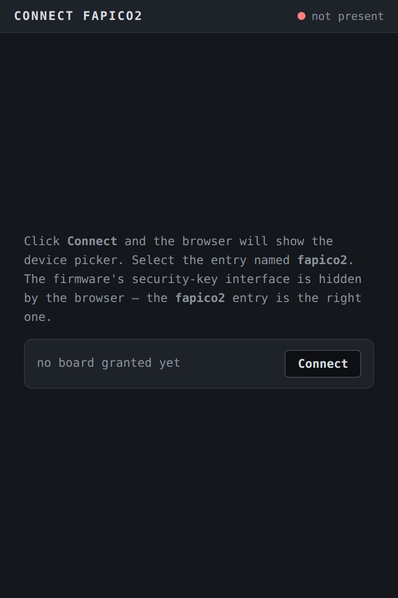
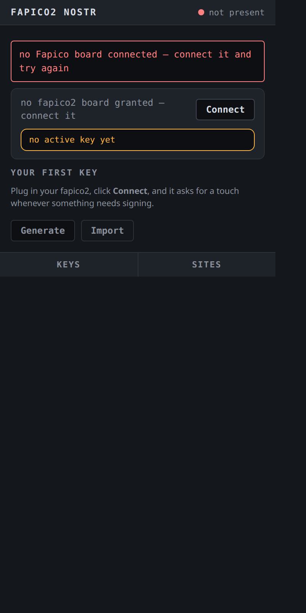

# Nostr identities

The board holds up to **eight Nostr identities** and signs with them: BIP-340 (Schnorr) event signatures and NIP-44 v2 encryption, computed **on the chip**. The private keys never leave the device — custody is **import-only**, and the backup for an imported key is the paper `nsec` from the software step, not a copy on the host. The same posture the rest of the board applies to passkeys and PGP keys, applied to a social identity that cannot be revoked by anyone.

This guide walks the whole journey through the **fapico2 Nostr extension** — the browser extension that speaks the board's vendor protocol over WebHID and exposes the standard NIP-07 `window.nostr` API to web pages. Any Nostr web client that consumes `window.nostr` can sign through the board.

The companion pages: [what the applet is and how it works](../features/nostr.md) (architecture, commands, storage), and the book's general [using-the-device](../using/index.md) rules, which the Nostr applet follows for the touch.

## 0. What you need

- A fapico2 board on the `feat/nostr` firmware or later (the applet ships in the same UF2 as everything else — no separate image).
- Chrome, Chromium, Edge or another Chromium-browser version **116 or newer** — the extension is MV3 and talks WebHID, which Firefox does not ship.
- **Linux only, once:** a udev rule so Chrome's WebHID chooser can see the board's vendor HID interface. A custom VID owns no `uaccess` by default, and without the rule the device is absent from Chrome's chooser *before any extension code runs*. The rule ships in the repo:

```bash
sudo cp platform/udev/70-fapico2-nostr.rules /etc/udev/rules.d/
sudo udevadm control --reload-rules && sudo udevadm trigger
```

The rule is scoped to the `fa20` vendor ID and deliberately does **not** match a PID — the board's VID/PID is runtime-writable, and a PID-bound rule would silently stop working after you re-identify the board. The discriminating check: `lsusb` sees the device but Chrome's chooser does not ⇒ this rule is missing.

## 1. Install the extension

The extension ships its built `dist/` in the repository, so the short path is to load it directly:

```bash
git clone https://github.com/eddieoz/fapico2-nostr-extension.git
```

Then in Chrome: `chrome://extensions` → enable **Developer mode** → **Load unpacked** → select the **`dist/` folder** (not the repo root — the manifest lives in `dist/`). Pin the "fapico2" action icon to the toolbar.

If you build the extension from source instead, `npm ci && npm run build` regenerates `dist/` (esbuild; target Chrome 116).

> **Windows/macOS:** no udev rule is needed — WebHID grants work from the browser's own permission flow.

## 2. Connect the board

Click the toolbar icon → **Connect**. The extension opens a real browser tab for the chooser, because Chromium cancels a device chooser anchored to an action popup. Click **Connect** there, pick the **fapico2** entry, confirm. One thing the connect page says that is worth repeating: the board's *security-key* interfaces are hidden by the browser's chooser — the **fapico2** entry (the vendor interface) is the right one.



- **First run, no keys yet:** the page stays open and says *connected — open the fapico2 toolbar icon to create your first key*.
- **Returning user:** the page closes itself after a moment and the popup shows the Keys screen.

The popup's home state mirrors the board honestly: **fapico2 board connected**, **no fapico2 board granted — connect it**, **device error — try again** (with a Try-again button), or **busy — retrying in a second**. Until a board is granted, the home screen is the *Your first key* ritual — *Plug in your fapico2, click Connect, and it asks for a touch whenever something needs signing* — and key operations stay out of reach; the extension never fakes readiness.



## 3. Create your first key — the choice that matters

There are two paths, and the README states the trade plainly. Read this before clicking either:

- **Recommended — generate in software, write the nsec down, then Import.** The paper copy exists *before* the board is involved, so a lost, bricked or wiped board does not cost the identity. Generate an `nsec1…` with any offline Nostr tool, then use **Import**. This is the only path that produces a backup.
- **Generate on the device** is for a user who has decided the board is the only copy — **permanently**. Custody is import-only: there is no export command, on any firmware, so a device-generated key can never be read off the board. A lost, wiped or bricked board costs the identity. For anything you cannot afford to lose, use the import path above.

### Generate (on the board)

Keys screen → **Generate** → pick one of the **8 slots** → **Generate &amp; touch** → touch the board's BOOTSEL button when the amber bar says *touch your device*. The popup confirms `key generated in slot N`. If no active key is set yet it adds: *no active key is set yet; pick it on the Keys screen to sign with it*.

### Import (from software)

Keys screen → **Import** → paste an `nsec1…` bech32 key or a 64-hex scalar into the password field → **Check secret** (validated locally — the paste is scrubbed from the page the moment it is checked) → the confirm step shows *This imports the key that publishes as npub1…* and the slot picker → **Import &amp; touch** → touch the board.

The board derives and echoes the public key (npub) before it accepts the write; an invalid scalar is refused without a touch.

## 4. The Keys screen

Every identity is listed as its label (or *slot N*) with a clipped npub. The radio picks the **active key** — the identity `window.nostr` publishes as — instantly and without a touch; the notice reads *active key is now slot N — sites that cached your other npub will need to reconnect*. An occupancy strip (**N/8 slots ■■···**) shows how much of the set is committed.

Per-key actions live on each row: **copy** the npub, **label** it, **delete**.

### Label

*Set label* accepts up to **32 UTF-8 bytes** with a live byte counter (`N/32 bytes`), gated by **Set label &amp; touch**. Labels are stored on the board and listed touch-free afterwards — which is why a label is part of the public surface: anything listed without a touch is public.

### Delete

*Delete key* names exactly what it destroys — *This destroys **name** — npub1… (slot N). The key is gone from the device.* — and requires the confirmation checkbox *I understand this is permanent — the key is destroyed on the device* before **Delete &amp; touch** lights up. After the touch, the board answers with the destroyed identity's npub and the extension verifies the echo — a mismatch is reported as a store fault, never a green checkmark. If you are deleting the active key, the popup warns *This is your active key — after deleting, the active key resets to slot 0.*

## 5. The board PIN — session custody

The identity set can sit behind a **board PIN**. It is optional — a PIN-less board behaves exactly as before — but once set, every command that uses or changes the private key set (sign, encrypt, decrypt, generate, import, delete, label) refuses with *session required* until you verify. The three reads stay open: an npub is public even from a locked board.

The popup earns its PIN surface from the board's `GET_INFO`: the **PIN row** shows the offer while no PIN is set, and the **manage** entry once custody exists.

- **Set** — *a PIN guards every key on the board: signing asks for it after each restart, and too many wrong tries lock the device. 6 to 64 characters.* Validated locally before the board is asked.
- **Verify** — and note the rule the device enforces: *setting the PIN does not open the session — verify it now to unlock signing.* If the verify screen appears mid-operation, it names what was interrupted — *verify and the "signs events" you started continues where it left off* — and the form you were filling resumes after.
- **Session lifetime** — *it stays open until the board restarts.* The session is RAM-only on the board: a power cycle closes it (verifying again after a restart is normal, not a fault), unplugging and replugging without a power cut does not, and switching between the extension and a PC/SC tool does not either. The device card shows *unlocked — until the board restarts* while the session is open; **Lock** closes it early.
- **Change** — the current PIN is verified first, *a wrong one burns an attempt, exactly like a wrong unlock*, and changing the PIN never opens or closes the session.
- **Lockout** — a wrong PIN has a durable three-attempt budget on the board (it survives restarts). At `0` the device is locked and the popup says it plainly: *the device is locked — too many wrong PINs. Recovery is a factory reset from the management applet, which destroys every identity on the board.* There is no back door; that is what the PIN is for.

The PIN itself is never stored — the board holds a verifier, and the PIN never leaves the host's password field.

### The sealing ceremony (one-time, offered, permanent)

On top of the PIN, the popup may offer to **seal** the identities — the banner appears at connect whenever the board advertises a pending migration (a PIN is set and the ceremony has not run). The dialog discloses, in order: *the ceremony seals every identity on the board with a device-bound key — one-time, permanent protection against old-firmware extraction*; *it is irreversible: once run, the identities can never be read by the old firmware again*; *it takes at most a minute — leave the board plugged in; the button is not needed*; and what a forgotten PIN costs — *generated identities are unrecoverable, imported identities come back from your backup file*.

Declining is a recorded choice: a dismissible notice (*the identities on this board are still readable by the old firmware — the sealing ceremony remains available*) stays, and the offer returns at every connect. The firmware never runs it as a side effect — the only command that burns the OTP secret is the explicit one the button sends.

## 6. Sign from a web page (NIP-07)

Any page can ask the standard API:

```js
const pubkey   = await window.nostr.getPublicKey();
const signed   = await window.nostr.signEvent(event);   // NIP-01 event object
const ciphertext = await window.nostr.nip44.encrypt(peerNpub, plaintext);
const plaintext  = await window.nostr.nip44.decrypt(senderNpub, payload);
const keys     = await window.nostr.listKeys();
```

The extension deliberately implements **no `nip04` and no `getRelays`** — it delivers a signer, not a Nostr client. There is no relay pool to configure; publish the signed event with any client or relay library you already use.

**What a signature request looks like.** The first time a site calls a method, the extension opens a small approval window: the site's host, a chip naming the action (*signs events*, *encrypts for a peer*…), a preview of the payload, the identity line (*with npub1… (slot N)*), the hint *Nothing is signed, encrypted or decrypted until you approve*, **Deny** / **Approve** buttons, and a *Remember this choice* checkbox. After you approve, the window flips to the amber state — *touch your fapico2 board* — and **the physical press is the final consent**. The footnote says it outright: the window approves the request; the touch signs it.

Three properties worth knowing:

- **The event is hashed in the browser; only the 32-byte sighash reaches the board.** The device returns the 64-byte BIP-340 signature and the npub that produced it — the extension verifies the npub echo, so a board signed with the wrong identity cannot paper over as success.
- **The nonce for NIP-44 encryption is generated on the device**, never supplied by the host, so no browser bug can reuse one.
- **Grants are per site and per action.** *Remember* on "signs events" for `example.com` says nothing about `other.net`, or about "encrypts for a peer" on the same site. Session grants die with the browser session. Manage them on the popup's **Sites** screen, which lists each host's remembered actions (*reads your public key, signs events — 2026-10-13*) with per-host revoke and a two-step **Revoke all** (**Confirm revoke all** holds for five seconds before it acts).

## 7. The touch, timeouts, and what the errors mean

The board asks for the BOOTSEL press on every command that uses or changes the private key set — sign, encrypt, decrypt, generate, import, label, delete. The three reads (public key, list, ping) are touch-free. There is **no config bit** that turns the touch off.

On a PIN-set board there is a gate in front of the touch: an unverified session is refused before the button ever lights, and the popup routes you to the verify screen instead (section 5). A touch you press while the session is closed consents to nothing — the refusal consumes the armed grant, never a signature.

The amber touch bar appears the moment the board asks; keepalives keep it live while the board waits. If no press comes, the device refuses with its touch status word and the extension reports it in plain words:

| The popup says | What actually happened | What to do |
|---|---|---|
| *touch timed out — the device asked for a touch and none came* | the board's touch window expired (`6985`) | try again; press when the amber bar pulses |
| *that slot is occupied — delete it first* | generate/import onto a live slot (`6A84`) | pick another slot, or delete the occupant |
| *that identity is not on the device* | the slot is empty or tombstoned (`6A82`) | check the Keys screen |
| *the device refused the data — it could not read the request* | malformed payload (`6A80`) | check what you pasted / the request shape |
| *the device refused the command length* | the counterparty's key is not a valid curve point (`6A87` on the device — the extension's map words it as a length refusal) | check the counterparty's npub |
| *the device could not complete the operation — its store faulted* | the store refused (`6F00`) — boot degraded or a slot that would not open | reflash/recovery; see [troubleshooting](#10-troubleshooting) |
| *the device does not serve that command* | unknown command (`6D00`) — usually a firmware older than the extension | update the board's firmware |
| *your PIN is needed first* | a gated command answered `6982` — the session is closed (fresh power-up, or LOCK) | verify the PIN; the interrupted operation resumes |
| *wrong PIN — N attempts left* | the budget answered (`63C1`–`63C3`) | the count is durable; enter the right one |
| *the device is locked — too many wrong PINs. Recovery is a factory reset from the management applet, which destroys every identity on the board* | `63C0` — the three-attempt budget is spent | deliberate act only; see [what management RESET does](#9-what-management-reset-does) |
| *ceremony interrupted — the worker restarted mid-operation; try again* | the extension's background worker restarted | retry once |
| *no Fapico board connected — connect it and try again* | no granted device at all | Connect first |

There is **no silent retry loop** for the touch: a refused request stays refused, and a second request waits its turn in a queue instead of stampeding the board.

## 8. Retiring a compromised key — the order is load-bearing

If an `nsec` leaks:

1. **Publish the NIP-09 (or kind-0) retirement event signed by the old key first.** It may be the last thing that key ever signs.
2. **`DELETE_KEY`** on the Keys screen, touch-gated (and PIN-verified, when a PIN is set).

Delete first and the retirement event can never be signed by anyone — the identity is stranded, not revoked. The board has no networking stack and cannot do this for you (NIP-46 remote signing is rejected by design). If the paper copy of the leaked key still exists, destroy it deliberately — deleting the key from the board does not un-publish it.

## 9. What management RESET does

The management applet's **RESET destroys all eight Nostr identities along with FIDO, OATH and OpenPGP** — the board's PIN dies with them, so a lockout is recoverable by the same act that empties the device. "Reset" means empty, and the host is obligated to enumerate (LIST_KEYS) and show what will be destroyed before you acknowledge. The scoped CTAP2 `authenticatorReset` (the one a browser or `ykman fido reset` triggers) wipes **only FIDO's range** and leaves Nostr records sealed and intact — the device-bound key derivation depends on nothing the FIDO reset destroys.

## 10. Troubleshooting

**The board does not appear in Chrome's chooser.** Linux: the udev rule from step 0 is missing (or not reloaded). Check `lsusb` shows `fa20:` and re-run the `udevadm` lines.

**The chooser shows the board but Connect fails.** Another app may hold the interface; close Yubico Authenticator/`ykman` for the moment. Then **Try again** on the popup's device card.

**Every touch-gated command answers the touch-timeout sentence.** The press went to the wrong interface or nothing was listening — confirm the amber bar was actually pulsing when you pressed. On boards flashed before the presence fixes, the CCID prompt can sit dark while the window is open; re-flash the current image.

**Sites cached an old npub after I switched the active key.** Expected — the notice said so at switch time. Reconnect the site (re-grant it) and it picks up the new active identity.

**"device error — try again" right after unplugging.** The next request reopens the transport; one Try-again is usually enough.

**The board answers but the extension cannot find it after a reflash.** If you changed the board's VID/PID, only the PID is allowed to differ from the rule's expectations — the udev rule keys on the vendor ID alone, so a custom **VID** is the one change that strands the chooser. Restore `fa20` with `scripts/fix_usb_identity.py`.
