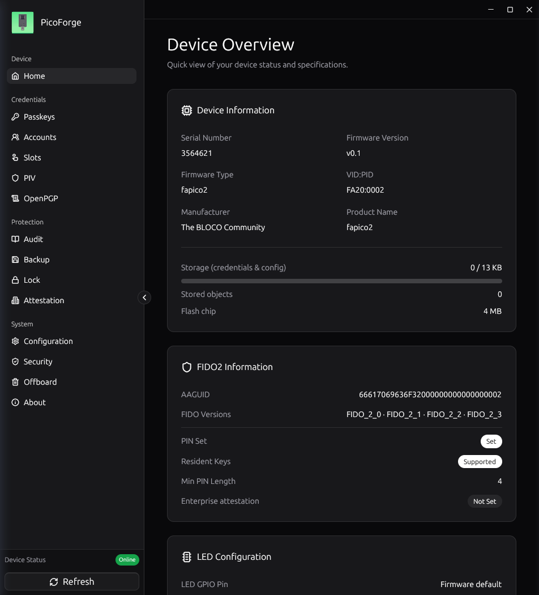
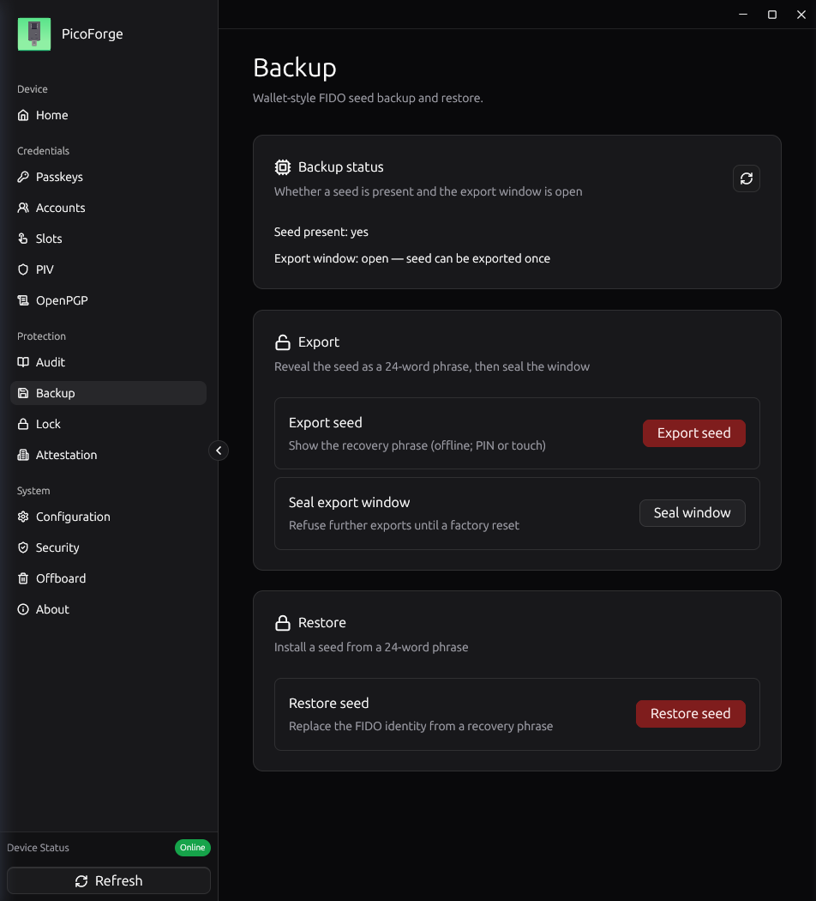
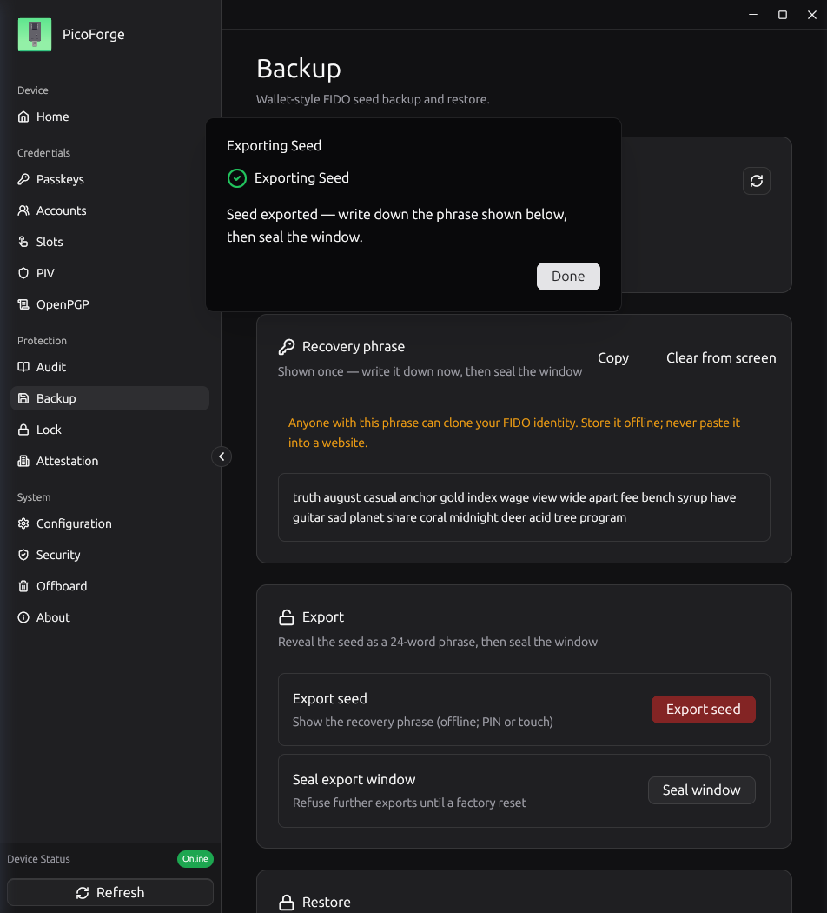
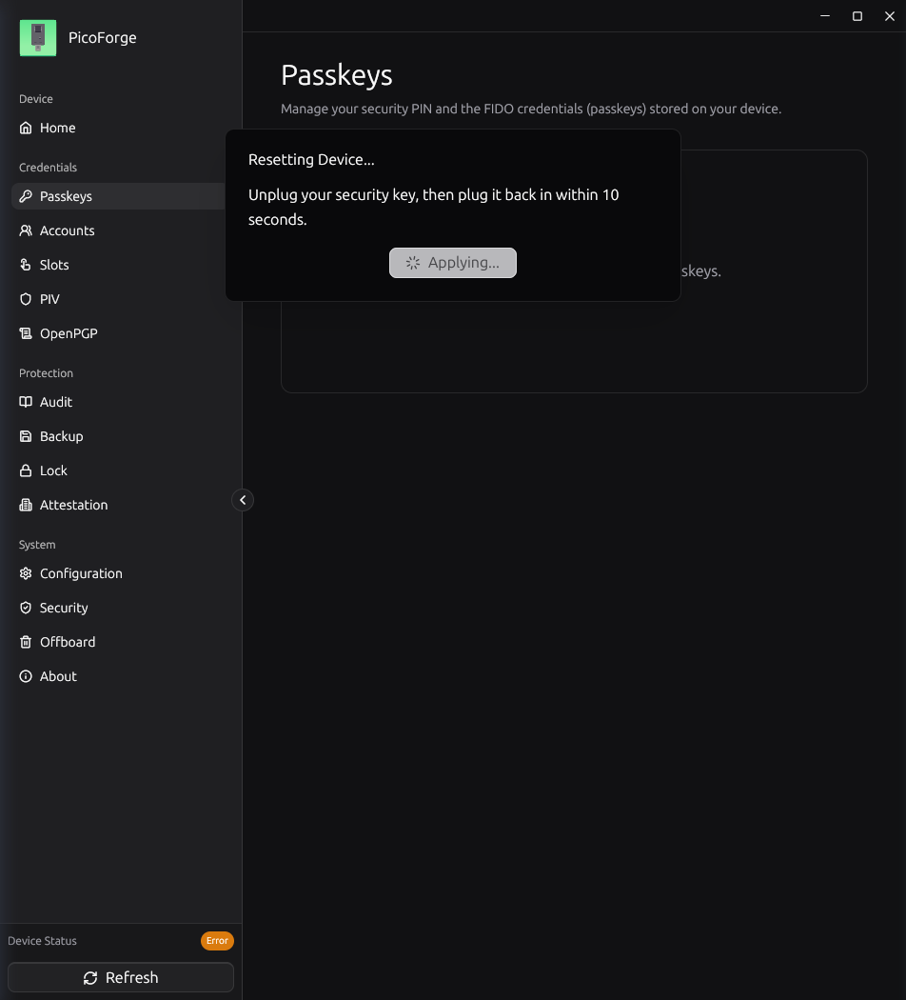
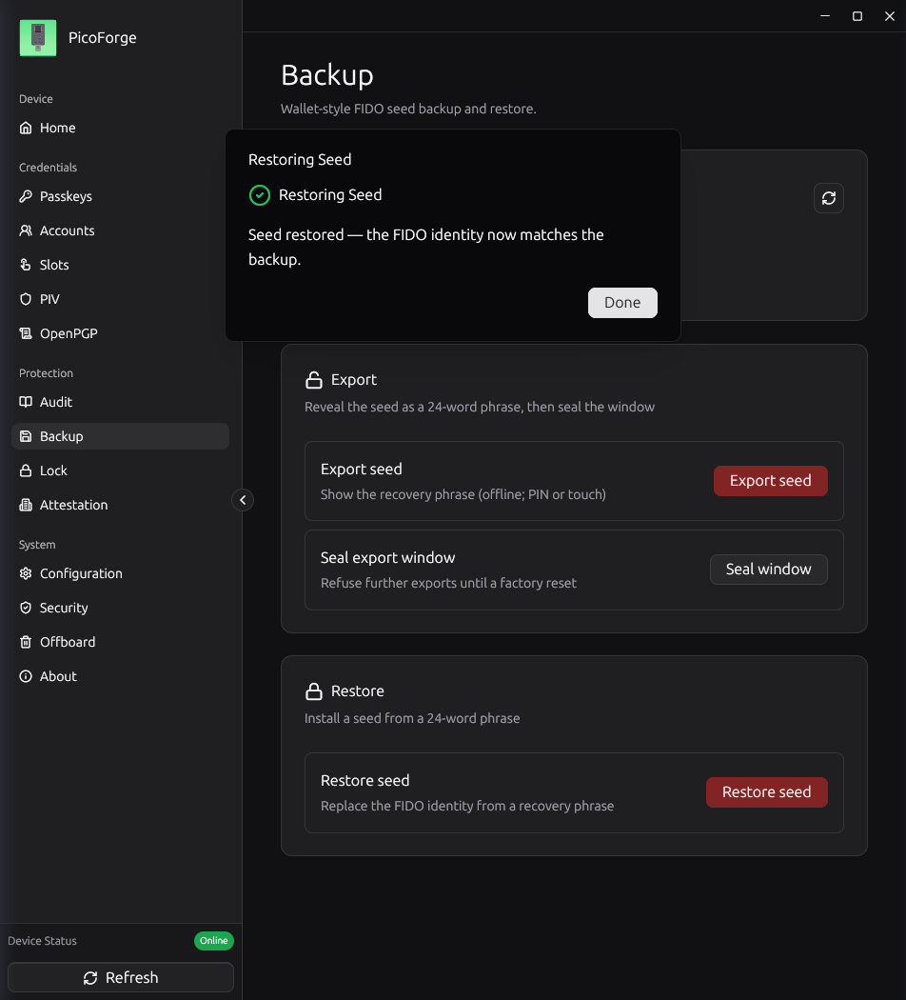
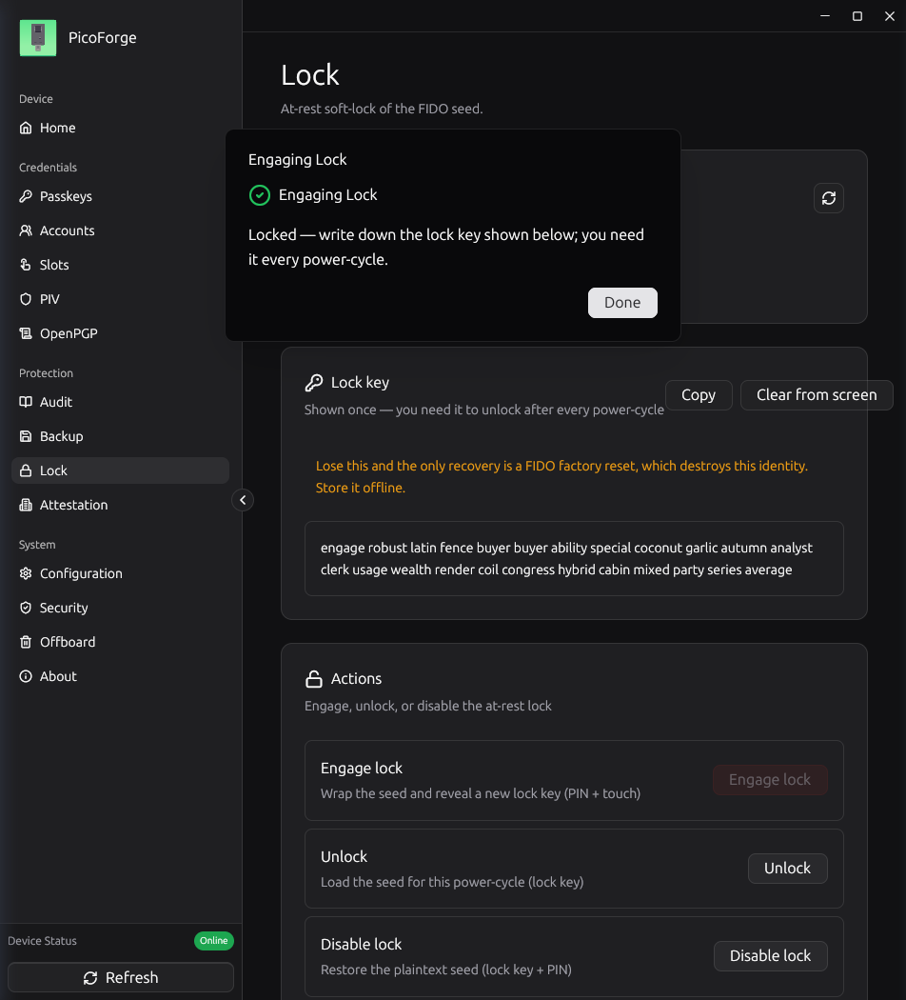
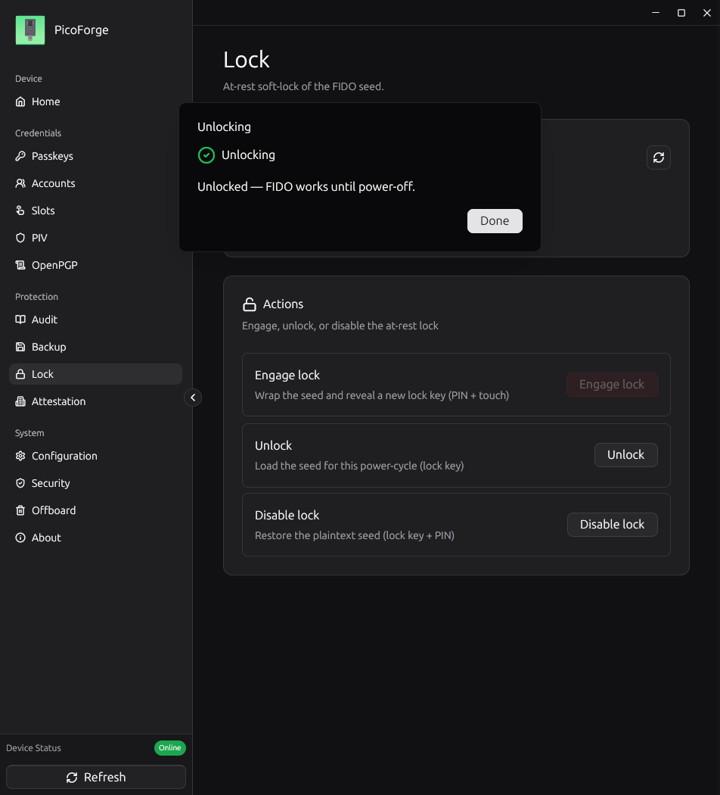
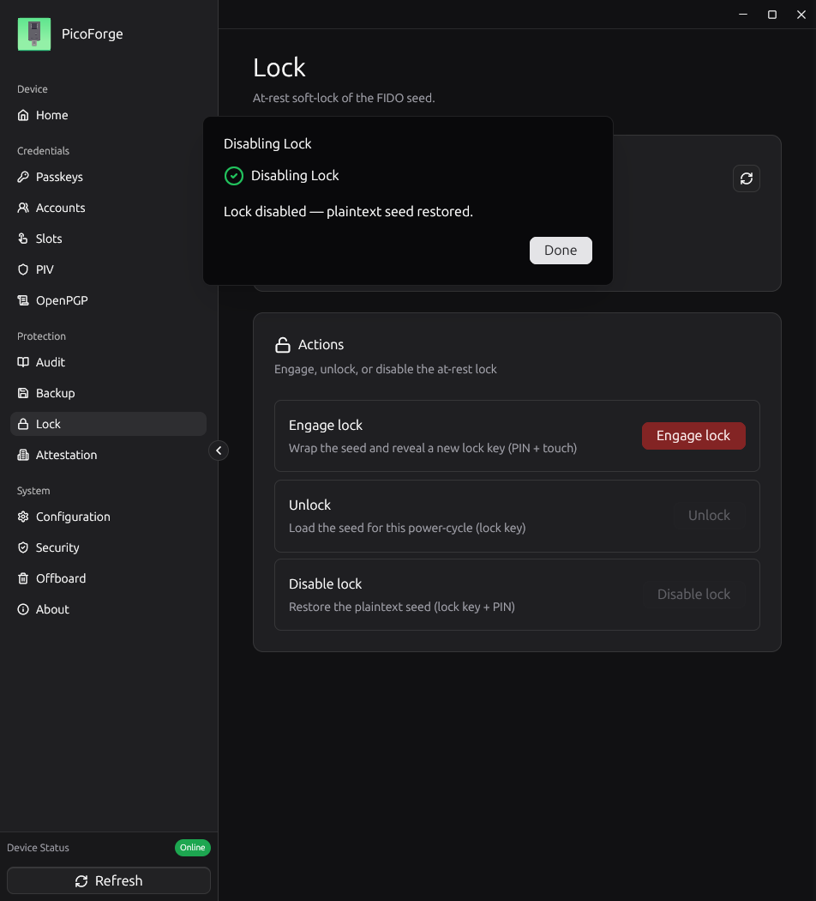
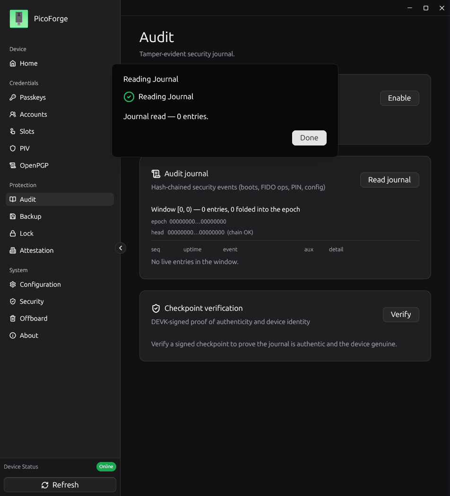
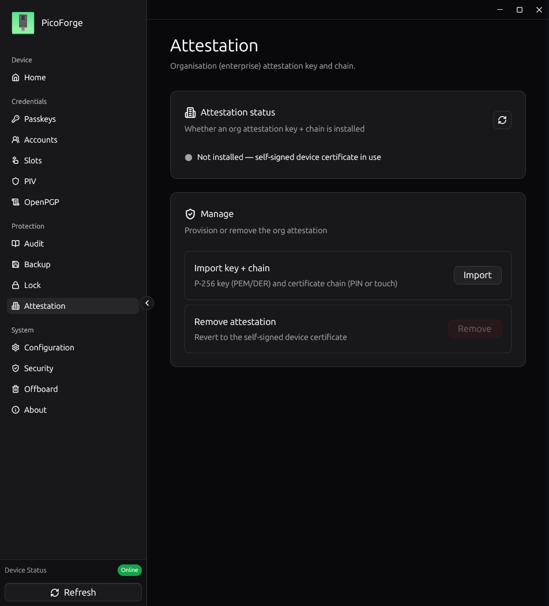

# The GUI proof: PicoForge drives the full cycle on a stock fapico2 board — `SAME-KEY`

**Date:** 2026-11-07
**EPIC:** [PF-FAPICO2](../tasks/EPIC-picoforge-fapico2-support.md) (US-1758)
**PR:** [eddieoz/picoforge#1](https://github.com/eddieoz/picoforge/pull/1) — branch `feat/fapico2-support`
**Predecessor:** the script-driven [`2026-10-31-seed-restore-proof.md`](2026-10-31-seed-restore-proof.md) (`SAME-KEY`); this transcript repeats its cycle **driven through the PicoForge GUI**.
**Board:** one RP2350 board, USB identity `fa20:0002` ("The BLOCO Community fapico2"), **stock AAGUID** `66617069636F3200…0002` — no override, no reflash.
**App:** `picoforge` release build of `feat/fapico2-support` (with the D8 fix, commit `5554089`), running on the tester's desktop; every screenshot below is the app window on X11.
**PIN:** `1758` (test PIN, set fresh for this ceremony; wiped-passcode board).

## What this closes

US-1758's scenario: the GUI shows the device as "fapico2" with the Backup
screen Ready, exports a 24-word phrase, the board is reset, the phrase is
restored through the UI, and the same passkey re-registers **byte-identically**
(`SAME-KEY`). Plus Lock engages and releases, Audit reads a journal, and
Attestation reports state.

## The cycle, as driven

| step | action | driver | touch |
|---|---|---|---|
| 0 | board found seedless; a fresh seed installed (`restore --generate`) and PIN set | script (prep) | yes |
| 1 | passkey #1 registered (rp `fapico2-probe.local`, user `probe`, rk=true) + sanity assertion | python-fido2 | yes ×2 |
| 2 | sidebar badge + Device Overview read **Firmware Type: fapico2** | GUI | — |
| 3 | Backup screen **Ready** (capability gate) | GUI | — |
| 4 | **Export seed** via dialog with the FIDO PIN → 24-word phrase | GUI | no (token) |
| 5 | phrase verified **byte-identical** to the prep seed | `diff` | — |
| 6 | **Factory Reset** via Passkeys → Reset (residents wiped; seed and PIN survive — fapico2 semantics) | GUI + replug | yes |
| 7 | **Restore seed** via dialog: phrase pasted + PIN → "the FIDO identity now matches the backup" | GUI | no (token) |
| 8 | passkey #2 registered, same rp/user | python-fido2 | yes |
| 9 | compare #1 vs #2 | script | — |
| 10 | Lock: **Engage** (PIN + touch) → lock key shown; **Unlock** (key + PIN); **Disable** (key + PIN + touch) | GUI | yes ×2 |
| 11 | Audit: **Read journal** (PIN) → journal renders, chain OK | GUI | no |
| 12 | Attestation: state reads **"Not installed — self-signed device certificate in use"** | GUI | no |

## The transcript

**Steps 2–3 — classification and the capability gate.** The Device Overview
names the board **fapico2** (not pico-fido, not RS-Key) and the Backup screen
renders Ready because of `supports_rskey_vendor()` — the US-1754 gate:





**Step 4 — export through the dialog.** PIN entered in the dialog (no touch —
the token MAC gates it), the phrase revealed once:



```
$ diff <(norm prep) <(norm gui)
PHRASES IDENTICAL — GUI export round-trips the prep seed
```

**Steps 6–7 — reset and restore through the UI.** Factory Reset asks for a
replug (fapico2's CTAP2 reset wipes residents; the seed and PIN survive —
recorded below as a divergence-adjacent behaviour), then the restore dialog
takes the pasted phrase:





**Steps 8–9 — `SAME-KEY`:**

```
passkey1 cred: d752bea896f91b9d2fc26829eefa837b4b912ad57826069966b091efb0f00728
passkey2 cred: d752bea896f91b9d2fc26829eefa837b4b912ad57826069966b091efb0f00728
passkey1 x: 7700c5f142ea0ec363e2e9a32b31c33dd36e0916be3f1f6a9846de3e85d312ea
passkey2 x: 7700c5f142ea0ec363e2e9a32b31c33dd36e0916be3f1f6a9846de3e85d312ea
passkey1 y: bc6d9ccf3483e4c8c389133c137500e8a2d9b3ccf251d5fd59bee259481763b9
passkey2 y: bc6d9ccf3483e4c8c389133c137500e8a2d9b3ccf251d5fd59bee259481763b9

credential IDs : EQUAL
public keys    : SAME-KEY
assertion signed after restore: True  (70-byte signature)
```

(The credential ID equals the 2026-10-31 proof's — the deterministic
`(rp, user.id)` derivation — while the key equality is the seed-rooted
derivation doing its job across a GUI-driven reset + restore.)

**Step 10 — Lock engages, unlocks, and releases.** Engage wrapped the seed and
revealed the lock key; Unlock loaded it for the power cycle; Disable restored
the plaintext:







**Steps 11–12 — Audit and Attestation:**





## The hardware finding: divergence D8 (fixed in the PR)

The first Unlock attempt answered **`0x36`** with PicoForge's message
"device requires a PIN — enter it". Root cause: fapico2 gates `UNLOCK (0x06)`
as `TokenOptional(0x20)` (`apps/fido/src/vendor41.rs:395`) — with a PIN set on
the board the token becomes mandatory — while RS-Key treats the same
sub-command as pure possession, so PicoForge's lock flows (which sent no
token) had never met the gate.

Fix: `unlock_with_lock_key()` (`picoforge/src/hal/fido/mod.rs`, commit
`5554089`) keeps the first attempt **token-less — byte-identical to the
previous wire shape, so RS-Key behaviour is untouched** — and retries with the
pinUvAuth MAC only when the device answers `0x36` and a PIN was collected. The
Unlock dialog gained an optional FIDO PIN field. All 148 host tests stayed
green; the retest through the GUI unlocked and disabled cleanly.

Two smaller observations, recorded not fixed:

- fapico2's CTAP2 `authenticatorReset` wipes residents but **not** the seed
  and not the PIN (the app's "Reset canceled" banner after the replug timeout
  was cosmetic — the wipe had happened). The backup tooling's own reminder
  states that `finalize`, not reset, closes the export door.
- The app's reset flow gives 10 s to replug; a slow hand times the banner out
  while the board is already back — harmless once the refresh is pressed.

## Verdict: `SAME-KEY` through the GUI

Every leg of US-1758's scenario passed on a stock-AAGUID board driven through
the PicoForge UI: classification, capability-gated Backup, export (phrase
identical), reset, restore, byte-identical re-registration, a signature under
the restored key, and Lock/Audit/Attestation. The pico-fido path is untouched
by the PR (the capability helper's PicoFido/LK-ONE regression tests pin it).
